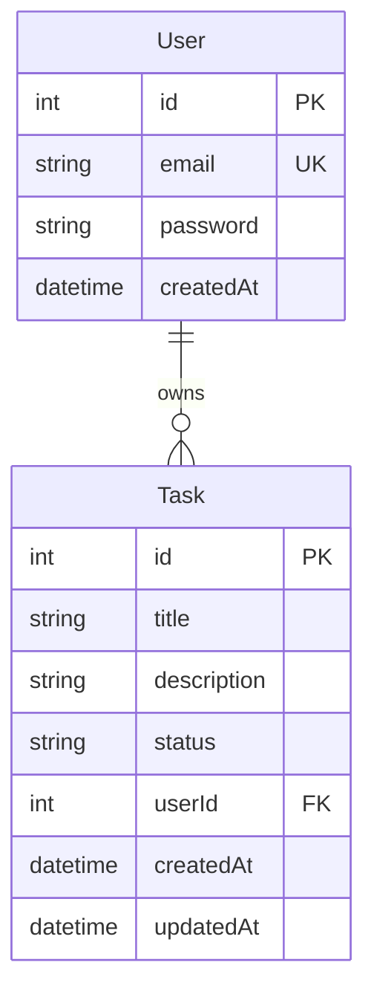

# 📋 Task Management REST API

[](https://nestjs.com/)
[](https://www.typescriptlang.org/)
[](https://www.prisma.io/)
[](https://www.sqlite.org/)
[](https://jwt.io/)
[](https://swagger.io/)
[](https://jestjs.io/)
[](LICENSE)

Kurumsal seviyede **Clean Architecture**, **JWT Authentication** ve **Task CRUD** operasyonlarını içeren modern, güvenli ve test edilebilir bir RESTful Backend servisidir.

NestJS modüler yapısı, Prisma ORM veri erişim katmanı ve otomatik Swagger/OpenAPI dokümantasyonu ile geliştirilmiştir.

---

## 🌟 Temel Özellikler

- 🔐 **Kimlik Doğrulama & Yetkilendirme (Auth):**
  - Güvenli parola hashleme (`bcrypt`).
  - JSON Web Token (JWT) tabanlı stateless oturum yönetimi.
  - `Passport-JWT` stratejisi ve `@UseGuards(AuthGuard('jwt'))` ile korunan endpoint'ler.
- 📝 **Görev Yönetimi (Task CRUD):**
  - Kullanıcıya özel görev oluşturma, listeleme, güncelleme ve silme.
  - Bir kullanıcının yalnızca kendi görevlerini yönetebilmesini sağlayan veri izolasyonu.
- 🛡️ **Validasyon & Veri Doğrulama:**
  - `class-validator` ve `class-transformer` ile Global Validation Pipe desteği.
  - Tip güvenli Request DTO (Data Transfer Object) kontrolleri.
- 📖 **Otomatik API Dokümantasyonu (Swagger):**
  - `/api` adresinde etkileşimli Swagger UI.
  - Bearer Token kilitleme desteğiyle test edilebilir dokümantasyon.
- 🗄️ **Prisma ORM & Veritabanı:**
  - Deklaratif şema yönetimi (`schema.prisma`).
  - Hızlı prototipleme ve test için SQLite (PostgreSQL / MySQL'e tek satırda geçilebilir).
- 🧪 **Unit Testleri:**
  - Controller ve Service katmanları için Jest test dosyaları (`*.spec.ts`).

---

## 🏗️ Veritabanı Şeması (ER Modeli)



---

## 📡 API Endpoint Referansı

### Kimlik Doğrulama (Auth)
| Metot | Endpoint | Açıklama | Kimlik Doğrulama |
| :--- | :--- | :--- | :--- |
| `POST` | `/auth/register` | Yeni kullanıcı kaydı oluşturur | Herkese Açık |
| `POST` | `/auth/login` | Giriş yapar ve JWT Token döner | Herkese Açık |

### Görev Yönetimi (Tasks)
| Metot | Endpoint | Açıklama | Kimlik Doğrulama |
| :--- | :--- | :--- | :--- |
| `POST` | `/task` | Yeni bir görev oluşturur | 🔒 Bearer Token |
| `GET` | `/tasks` | Giriş yapmış kullanıcının görevlerini listeler | 🔒 Bearer Token |
| `GET` | `/tasks/:id` | Belirli bir görevin detayını getirir | 🔒 Bearer Token |
| `PUT` | `/tasks/:id` | Görevi günceller (başlık, açıklama, durum) | 🔒 Bearer Token |
| `DELETE` | `/tasks/:id` | Görevi siler | 🔒 Bearer Token |

---

## 🚀 Kurulum ve Çalıştırma

### 1. Gereksinimler
* Node.js (v18 veya üzeri)
* npm veya yarn / pnpm

### 2. Kurulum
```bash
# Repoyu klonlayın
git clone https://github.com/siladgn/task-api.git
cd task-api

# Bağımlılıkları yükleyin
npm install
```

### 3. Ortam Değişkenleri
`.env.example` dosyasını `.env` olarak kopyalayın:
```bash
cp .env.example .env
```

### 4. Veritabanını Hazırlama
Prisma şemasını veritabanına senkronize edin ve istemciyi oluşturun:
```bash
npx prisma db push
npx prisma generate
```

### 5. Sunucuyu Başlatma
```bash
# Geliştirici modunda çalıştırma (Hot reload)
npm run start:dev

# Prodüksiyon derlemesi
npm run build
npm run start:prod
```
Sunucu varsayılan olarak `http://localhost:3000` portunda çalışacaktır.

### 6. Swagger Dokümantasyonu
Tarayıcınızdan aşağıdaki adresi açarak tüm API'yi canlı olarak deneyebilirsiniz:
👉 **`http://localhost:3000/api`**

---

## 🧪 Testlerin Çalıştırılması

```bash
# Birim (Unit) testleri çalıştırma
npm run test

# Test coverage raporu alma
npm run test:cov
```

---

## 📄 Lisans

Bu proje [MIT Lisansı](LICENSE) kapsamında açık kaynak olarak sunulmuştur.
